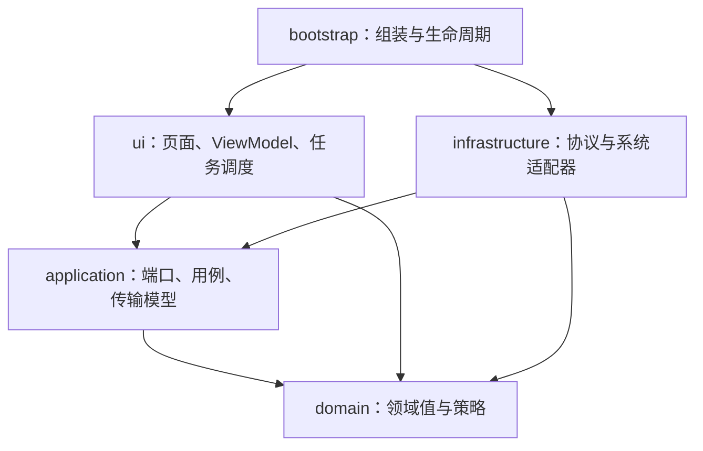

# 架构与包边界

项目采用单个 Gradle 模块，使用 Java 21、JavaFX 和 Groovy 构建脚本。`com.fuzzlauncher.Launcher` 继续作为 JAR 和 jpackage 的入口，资源仍放在 `/com/fuzzlauncher/`，包迁移不改变持久化文件的位置和格式。

## 依赖方向



`domain` 只依赖本层和 JDK；`application` 只依赖领域层、本层和 JDK。两层均不依赖 JavaFX、Gson、网络客户端或平台接口。`ui` 通过应用端口调用操作，不引用基础设施实现；`infrastructure` 不引用 UI、组合根和启动入口。只有 `bootstrap` 同时认识实现和界面，负责明确地通过构造器装配依赖，不使用依赖注入框架或服务定位器。

`ArchitectureTest` 从实际生产类输出目录加载字节码，检查上述方向及所有生产包之间的循环依赖。测试类不参与架构检查，测试替身可以实现应用端口。

## 包的职责

| 包 | 职责 |
| --- | --- |
| `bootstrap` | JavaFX 启动、实例锁、启动恢复、对象装配、重启与退出 |
| `domain.account` | 账号类型、身份与游戏会话 |
| `domain.instance` | 实例、隔离选项、隔离目录策略与路径规则 |
| `domain.game` | 游戏版本与加载器类型 |
| `domain.content` / `domain.mod` / `domain.modpack` | 可管理内容的类型和元数据、模组文件名规则与整合包格式 |
| `domain.settings` | 已校验的启动器设置、下载源标识和可见性策略 |
| `application.port` | 认证、仓储、版本目录、游戏安装与启动、设置、文件浏览等操作契约 |
| `application.model` | 不含协议 JSON 的界面读模型、操作结果和产品版本信息 |
| `application.task` | 与 JavaFX 无关的取消、进度与提交契约 |
| `application.usecase` | 模组目录解析与管理、启动参数解析等应用规则 |
| `infrastructure.auth` | MSAL、Xbox/Minecraft 认证与皮肤头像缓存 |
| `infrastructure.network` | HTTP、下载、并行调度、校验与镜像回退 |
| `infrastructure.game.catalog` | 游戏/加载器目录缓存与版本描述解析 |
| `infrastructure.game.install` | 原版安装、加载器适配、处理器执行与完整重装事务 |
| `infrastructure.game.runtime` / `game.launch` | 本地 Java 检测、JVM 兼容参数、命令构建和游戏进程 |
| `infrastructure.instance` | 磁盘实例扫描、实例文件操作与登记协调 |
| `infrastructure.mod` / `modpack` | 本地模组文件、元数据解析与整合包协议适配 |
| `infrastructure.config` | 发布配置、配置默认值和旧设置补全 |
| `infrastructure.persistence` | 原子 JSON、配置备份和 JSON 实例仓储 |
| `infrastructure.filesystem` | 可取消的文件复制、ZIP、物理路径、实例目录与有边界的工作区清理 |
| `infrastructure.settings` | 数据目录引导、设置保存与游戏目录迁移事务 |
| `infrastructure.recovery` | 持久化操作日志、快照及异常退出恢复 |
| `infrastructure.platform` / `platform.windows` | 可执行文件位置、日志、重启、子进程和 Windows 凭据/剪贴板 |
| `infrastructure.browser` | 文件浏览端口的本地实现 |
| `ui.shell` | 主窗口、可见性与登录/下载进度弹窗 |
| `ui.instances` / `downloads` / `accounts` / `settings` / `mods` / `modpack` / `about` | 各业务页面及其弹窗 |
| `ui.common` | Win95 控件、窗口装饰、选择器、图标与图片缓存 |
| `ui.viewmodel` | 共享只读状态、各业务 ViewModel 与展示依赖集合 |
| `ui.task` | JavaFX Task 调度、进度绑定、任务所有者与提交门禁 |

## 展示层与后台任务

`LauncherViewModel` 保留共享状态、业务 ViewModel 的组合与关闭流程，业务命令分别放在 `AccountsViewModel`、`CatalogViewModel`、`InstancesViewModel`、`SettingsViewModel`、`GamesViewModel`、`ContentViewModel` 和 `ModpacksViewModel` 中。模组、资源包和原理图各自装配一个 `ContentViewModel`，复用 `ContentPage` 的布局及后台目录解析和扫描流程。

各业务对象共享同一个 `PresentationState` 和 `FxTaskCoordinator`，因此拆分后仍只有一个全局操作门禁。页面切换仅取消属于该页面的目录请求；旧任务的完成回调不能清理新任务状态。提交阶段与取消操作通过同一把锁协调，退出时等待事务和头像任务释放资源。文件浏览、模组扫描和参数预览继续保留各自的后台读取及过期结果检查。

设置保存、实例扫描/修改和整合包解析的文件操作放在端口实现中。UI 接收 `ModpackInfo`、`ModpackContent`、`SettingsSaved` 等类型，不处理安装协议中的 `JsonObject`。启动参数文本解析位于应用层；Java 能力探测和具体 JVM 标志筛选位于运行环境适配器。

## 策略、适配与扩展

- `IsolationPolicy` 统一决定启动和内容管理使用的游戏目录。`ManageContent` 通过 `ContentRepository` 解析各类内容目录并调用文件操作。基础设施负责读取模组和资源包元数据，以及解析 Litematica 配置中的自定义原理图目录。
- `InstanceRepository` 隔离登记存储；JSON、备份和原子写入属于持久化实现。
- 加载器安装器通过 `Map<LoaderType, LoaderInstaller>` 明确注册，Fabric 与 Forge/NeoForge 分别适配各自协议。协议 JSON 留在基础设施层。
- 模组元数据按 `ModMetadataParser` 注册。Fabric、Quilt、Forge/NeoForge TOML 和旧 Forge 各有解析器；总读取器统一负责 ZIP 读取上限、取消、合并、图标边界和缩略图生成。重复条目注册会直接拒绝，增加格式无需修改入口分支。
- `LauncherOptions` 把展示所需的默认值和下载源标签作为只读数据传入 UI。领域枚举保存稳定标识，不读取全局配置或显示标签。

避免为简单值对象增加没有用途的接口；文件系统、HTTP、Windows 和安装协议的具体工作继续由明确的适配器实现。

## 整合包导入

`LocalModpacks` 只负责解析与选择导入内容，随后把内容准备回调交给 `LocalGameInstallation.installModpack`。安装器在已登记恢复日志的 `install-*` 私有工作区中创建 `profile`，直接将文件解压、下载到该目录；不再创建独立的 `pack-import-*` 目录并完整复制到第二份暂存目录。发布仍使用同文件系统内的目录移动，旧的普通安装与外部内容复制入口保留。

`StagedFiles` 仅在一次导入中存活，复用一个读写缓冲区，解压时同步计算 SHA-1 和 SHA-256。清单校验和恢复树复用相同文件代际的摘要；指纹包含文件标识、大小、修改及创建时间，已知覆盖、重新下载和元数据写入会主动使旧摘要失效。需要 SHA-512 或发现指纹变化时重新读取文件。实际回滚始终重新读取目标文件校验，避免内存摘要掩盖用户后续修改。

暂存文件仍在发布前逐个 `force(true)`，恢复日志仍在修改目标前持久化。解压、持久化、清单生成均使用同一取消上下文，失败清理与异常退出恢复仍由安装器管理。这里减少的是重复复制、属性写入与哈希读盘，没有通过删除提交前刷盘换取性能。

## 数据与兼容性

便携版和旧版当前用户安装版默认使用程序旁的 `game` 和 `data`。所有用户安装版由安装标记识别，默认使用各自的 `%LOCALAPPDATA%\FuzzLauncher` 存放数据，其下的 `game` 存放游戏。切换游戏目录或数据目录后按原有流程重启，迁移前保留确认和恢复记录。

游戏目录共享 `assets`、`libraries`。每个实例拥有稳定 ID，实际目录按实例名保存为 `versions/<实例名>/`，实例描述是 `.fuzz-instance.json`。启动工作目录和 `--gameDir` 使用同一隔离策略；共享模式下使用游戏根目录。旧 UUID 实例目录继续通过身份校验后迁移，拒绝覆盖、名称冲突和目录链接。共享基础版本保存在 `baseVerisons`，便携版和旧版当前用户安装版位于程序旁，所有用户安装版位于各自的 `%LOCALAPPDATA%\FuzzLauncher`。

原有设置、账号、实例、MSAL 缓存、操作日志及整合包描述不因 Java 包变化而迁移。JSON 序列化不包含 Java 类名。旧设置缺少的字段在反序列化适配器中补全，再构造已校验的领域对象；旧下载源 `BMCLAPI`、`NJU` 继续映射为 `MIRROR`。新设置写入稳定枚举标识。

游戏安装、完整重装加载器和目录迁移保留原有暂存、快照、提交、回滚及异常退出恢复顺序。删除实例仍要求用户确认，并只清理所属实例目录；共享目录和公共缓存保留。模块拆分不新增模组下载或 Java 自动下载。

## 验证与编码规范

```powershell
$env:JAVA_HOME = 'C:\Program Files\Zulu\zulu-21'
.\gradlew.bat test --tests '*ArchitectureTest'
.\gradlew.bat test '-Dfuzz.uiTests=true'
.\gradlew.bat preparePackage prepareJavafx
```

核心与 UI 回归覆盖旧配置、账号互斥、头像、取消、加载器重装、目录迁移/恢复、参数与内存、模组及整合包操作。真实联网安装仍需显式开启 `fuzz.integration`，本地回归不代表所有历史加载器已完成实际安装验收。

Java 代码遵循仓库 `.editorconfig` 与 `packaging/java-format.properties`：4 空格缩进、同行大括号、完整控制块，导入按项目、第三方、JDK、静态成员分组；不改为 Kotlin，也不引入新的运行时框架。
